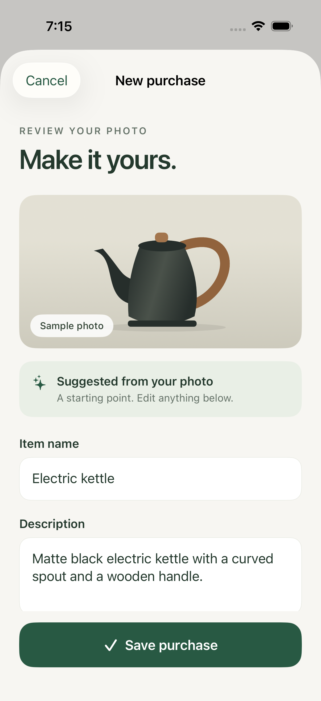

# Housekeeping for iOS

**A little order. More home.**

A SwiftUI app for finding household purchases, tracking restock needs and keeping purchase photos private. Two household members can share one inventory.

[See it in action](#see-it-in-action) · [Engineering highlights](#engineering-highlights) · [Run the demo](#open-the-prototype) · [Architecture](docs/architecture.md)

## See it in action

<p>
  
  
</p>

**Browse → search → add a purchase → review → save.**
The screenshots show the offline simulator demo with original artwork and sample data. Photo suggestions in this preview are scripted; live AI recognition is currently disabled.

The connected app adds shared inventory, quantity/restock limits, private photo access and recoverable editing. Hosted and physical-device acceptance remains in progress; see [current status](#current-status).

## Engineering highlights

| Challenge | Approach | Explore |
| --- | --- | --- |
| Keep the household’s data private | Household access policies, private storage and signed-in photo requests | [Architecture](docs/architecture.md) · [Access tests](supabase/tests) |
| Preserve unfinished edits | Account-scoped draft recovery and explicit conflict handling | [Draft store](ios/HouseKeeping/Data/LocalDraftStore.swift) |
| Handle photos safely | Prepare upright JPEGs, strip metadata and preserve recoverable upload checkpoints | [Photo preparation](ios/HouseKeeping/Services/PhotoPreparation.swift) |
| Make native flows usable | SwiftUI previews, light/dark modes and simulator checks for accessible text | [UI tests](ios/HouseKeepingUITests) · [Screenshot gallery](docs/design-preview/README.md) |

The demo runs in an iPhone simulator without account keys. This repository is a curated source showcase for a private household app.

## Current status

- **iPhone preview:** inventory search, sample-photo review, manual entry, details, dark mode, and compact accessible buttons. Uses session-only sample data and original vector artwork.
- **Backend:** two-member households, shared inventory, authentication, private photo lifecycle, recognition authorization, and service-role-only member-removal/household-closure operations. The approved Supabase project has all 17 migrations, the private bucket, the two-member household, and active authenticated `media` and `cleanup` Edge Functions. Local integration suites exercise Auth, PostgREST, Storage, Edge Functions, and account maintenance with disposable identities and bytes. See [local verification](docs/local-development.md) and [stock-value verification](docs/item-quantity.md).
- **iOS authentication:** sign-in, password setup/recovery, launch/foreground session restoration, household/account states, and sign-out are connected to native screens. Supabase Swift 2.55.1 uses device-only Keychain storage. Actual SDK login, restoration, and shared household lookup passed against disposable local accounts.
- **Persistent shared inventory:** account-scoped browse/search/pagination, fresh details, add/edit/delete, durable editor recovery, explicit discard, and conflict review are connected. Two-account and foreground-relaunch UI journeys pass on Pro and SE; the real local Swift SDK check passes shared CRUD and restoration. See [connected inventory status](docs/connected-inventory-development.md).
- **Quantity and restock limit:** each purchase shows its count and per-item threshold in the list and details. At or below the limit it displays **Restock now**; zero also displays **Out of stock**. Both values default to 1 and can be edited by either household member. See [stock behavior and verification](docs/item-quantity.md).
- **Photo drafts and saving:** library selection, upright metadata-stripped JPEG preparation, protected recovery, and explicit discard are connected to new-purchase editors. Saving uploads and attaches the photo with recoverable checkpoints and exact request retries. See [photo draft status](docs/photo-drafts-development.md).
- **Private photo display:** list thumbnails and purchase details download genuine attached images through the signed-in account. Confirmed photo removal retains purchase details. Displayed bytes are session-owned and never replaced with demo artwork after a failure. See [photo service status](docs/photo-service-development.md).
- **Native camera:** camera permission is requested only after an explicit capture action. Live capture, preview, retake, interruption handling, and denied-permission fallback feed the existing protected JPEG draft pipeline without saving to the Photos library. See [camera status](docs/camera-development.md).
- **Recognition review:** the provider implementation and offline sample remain tested, but live AI suggestions are disabled in the production composition until an owner-approved model, server-side API key, evaluation, and spending limit are configured. See [recognition flow status](docs/recognition-flow-development.md).
- **Remaining scope:** current work follows the [release-critical chain](docs/release-criticality.md): verify photo saving on both authorized phones, deploy and prove hosted account/data recovery operations, complete private installation, and run two-phone acceptance. Recognition stays disabled and undeployed until a provider, API key, evaluation, and spending limit are separately approved. Physical-device and remaining hosted checks are pending.

Start with the [local run guide](docs/local-user-guide.md), read the [user guide](docs/user-guide.md), or browse the [documentation index](docs/README.md). The guarded backend startup binds published ports explicitly to localhost. Bare `supabase start` exposes network ports on the tested setup. Keep development data synthetic; loopback binding is not production hardening.

## Requirements

For the preview: macOS with Xcode and an iPhone simulator (iOS 18 minimum; verified toolchain: Xcode 26.6). No account keys or signing team are needed for simulator builds.

For backend development: Docker, a complete Supabase CLI installation (tested: 2.109.1), Node.js 22, and Deno 2.9.5. A connected local app needs only the loopback project URL and its public publishable/anonymous key. Cloud deployment, private signing, and the two-phone release checks still require their authorized targets.

## Open the prototype

```sh
open ios/HouseKeeping.xcodeproj
```

Choose the **HouseKeeping** scheme and an iPhone simulator, then Run. Without configuration, the setup screen offers **Explore the demo**. Explore search, purchase details, and **Add a purchase → Try sample photo**. You can edit the suggestion and save it to the session's inventory. **Enter manually** starts an empty draft. Demo data resets on relaunch or re-entry; it never substitutes for failed live requests.

Named SwiftUI previews include inventory, dark mode, accessible text, photo review, and manual entry. To review without Xcode, open the [saved simulator screenshots](docs/design-preview/README.md).

## Connect your Supabase project: what to share

To prepare the app connection, share these details with the developer:

- **Project URL**, such as `https://your-project.supabase.co`.
- **Public publishable key**, starting with `sb_publishable_`; a legacy `anon` key is also accepted.
- **Project status:** whether this is a new, empty project or already contains data or serves another app.
- **Photo bucket name**, if you have already created one; otherwise say that no bucket exists yet.

The app expects a **private** bucket named `purchase-photos` in the same Supabase project.
Database and photo requests use the same project URL and the signed-in user's session;
no separate Storage URL, S3 credentials, or public photo links are needed. If your bucket
has a different name or is public, include that information so its configuration can be reviewed.

You can use this template:

```text
Project URL: https://your-project.supabase.co
Public publishable / anon key: ...
Project status: new and empty / existing (describe what it contains)
Photo bucket: not created / name and private-or-public status
```

Do not paste service-role keys, `sb_secret_` keys, database passwords, account passwords,
or Supabase access tokens into chat, issues, or this repository. Any administrative access
needed for deployment is configured separately on the operator's machine.

The public app settings belong in the ignored `ios/Configuration/Local.xcconfig`, using
[Local.xcconfig.example](ios/Configuration/Local.xcconfig.example) as the template.
For a hosted project, the URL setting uses xcconfig's escaped slash syntax:

```xcconfig
HK_SUPABASE_URL = https:/$()/your-project.supabase.co
HK_SUPABASE_PUBLISHABLE_KEY = REPLACE_WITH_PUBLIC_PUBLISHABLE_OR_ANON_KEY
```

Sharing these details identifies the target; a working cloud setup also requires the
project audit, database migrations (including quantity and restock limit), private Storage policies,
Edge Functions, authentication configuration, and two household accounts. Follow the
[cloud onboarding sequence](docs/release-criticality.md#critical-execution-order) before
using the connected app with real purchases. See [iOS configuration](docs/ios-development.md)
for build settings and authentication behavior.

## Repository layout

```text
ios/                  SwiftUI prototype, Xcode project, UI tests
supabase/migrations/  Database schema, policies, and transactional APIs
supabase/tests/       Rollback SQL tests and concurrent-session checks
docs/                 Product, architecture, contracts, design, and progress
```

## Design and specifications

- [Design direction and screen specification](docs/design.md)
- [Simulator screenshots](docs/design-preview/README.md)
- [Selected architecture](docs/architecture.md)
- [Product specification](docs/spec.md)
- [Data and interface contracts](docs/contracts.md)
- [Quantity and restock-limit specification](docs/item-quantity.md)
- [Private two-person household setup](docs/shared-household.md)
- [Implementation plan](docs/implementation-plan.md)
- [Implementation task checklist](docs/implementation-tasks.md)
- [Open-task criticality](docs/release-criticality.md)
- [Release acceptance matrix](docs/acceptance-results.md)
- [Account removal and recovery runbook](docs/recovery-runbook.md)
- [Local run guide](docs/local-user-guide.md)
- [End-user guide](docs/user-guide.md)
- [Complete documentation index](docs/README.md)

## Verify

```sh
xcodebuild -project ios/HouseKeeping.xcodeproj -scheme HouseKeeping -sdk iphonesimulator -destination 'generic/platform=iOS Simulator' -derivedDataPath /tmp/housekeeping-design-build CODE_SIGNING_ALLOWED=NO build
xcodebuild -project ios/HouseKeeping.xcodeproj -scheme HouseKeeping -showdestinations
# Set HK_SIMULATOR_ID to an installed simulator's UUID.
xcodebuild -project ios/HouseKeeping.xcodeproj -scheme HouseKeeping -destination "platform=iOS Simulator,id=${HK_SIMULATOR_ID}" -derivedDataPath /tmp/housekeeping-design-build CODE_SIGN_IDENTITY=- test
/usr/bin/ruby ios/Configuration/validate-public-key.test.rb
```

The UI tests exercise sign-in/retry, account switching, missing membership, recovery, explicit demo entry, review/edit/save/search, photos, recognition fallback, and accessibility journeys. Simulator screenshots are retained as test attachments. Debug launch arguments include `--demo`, `--preview-auth`, `--preview-recovery`, and `--preview-dark`; authentication previews are offline and visibly labeled. Hosted and physical-device acceptance remains open in the [release matrix](docs/acceptance-results.md).

Unit tests cover configuration, actual simulator Keychain operations, session states, and offline SDK requests. Simulator tests require local ad-hoc signing (`CODE_SIGN_IDENTITY=-`) for Keychain access; no Apple account or distribution certificate is used. See [iOS configuration and authentication status](docs/ios-development.md) before adding public project settings. No cloud credentials are needed to run these tests or the demo.

For this directory's isolated local test stack:

```sh
node scripts/start-local.mjs
node --test scripts/local-safety.test.mjs
supabase migration up --local
supabase test db
node supabase/tests/concurrency/households.mjs
node --test supabase/tests/integration/inventory.test.mjs
node --test supabase/tests/integration/recovery.test.mjs
node --test supabase/tests/integration/photos.test.ts
node --test supabase/tests/integration/account-maintenance.test.ts
deno test --config supabase/functions/media/deno.json supabase/tests/functions/media.test.ts
deno test --config supabase/functions/cleanup/deno.json supabase/tests/functions/cleanup.test.ts
deno test --config supabase/functions/recognitions/deno.json supabase/tests/functions/recognition.test.ts
deno test --config supabase/functions/account-maintenance/deno.json supabase/tests/functions/account-maintenance.test.ts
# Optional: uses temporary synthetic credentials, never a cloud project.
node scripts/test-ios-local-auth.mjs
supabase db lint --local --schema public,private --fail-on warning
supabase stop
```

Tests use synthetic `.invalid` identities, never personal inventory. Never add `--linked` or a cloud database URL to the local test workflow. `.gitignore` excludes credentials, environment files, local Supabase state, and build outputs; commit only placeholder configuration examples. Never put service-role keys or AI provider secrets in the iOS app.

Set `HK_SUPABASE_CLI` to a complete trusted executable if it is not on PATH. See the [local run guide](docs/local-user-guide.md), [HTTP fixture instructions](supabase/tests/integration/README.md), and [10,000-purchase performance baseline](docs/search-performance.md). The benchmark restarts only this project's database and should run separately from other local tests.
