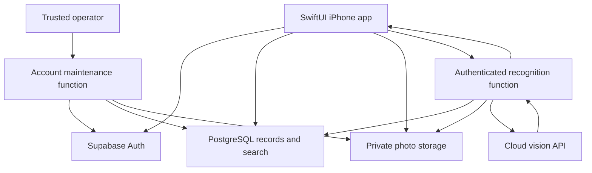

# Architecture decision: HouseKeeping

Updated: 2026-09-18. Status: the SwiftUI demo and connected app, Supabase household/inventory APIs, private photo lifecycle, recognition boundary, and service-role-only account-maintenance controls are implemented and verified locally. The approved project has all 17 migrations, a private photo bucket, the two-member household, and active authenticated `media` and `cleanup` functions. Recognition remains disabled and undeployed. Hosted photo/recovery proof, private signing, and two-phone acceptance remain open.

## Selected architecture

Build a native SwiftUI iPhone app backed by Supabase Auth, PostgreSQL, and private Storage. Use authenticated Supabase Edge Functions for the private photo lifecycle. An optional recognition function may turn a product photo into an editable suggestion through a cloud vision API after separate provider and spending approval. Use SQL functions for transactional operations. A dedicated NestJS service is unnecessary for the initial scope.

This decision prioritizes a native camera experience, searchable purchase records, shared access for the user and his wife, and a small amount of backend code to maintain. Local search performance has a wide margin against its target; cloud/device timing and recognition quality remain unmeasured.

The user selected SwiftUI + Supabase after reviewing the architecture recommendation. The selected stack replaces the original NestJS/Next.js proposal.

## Confirmed intent and assumptions

Confirmed: track household purchases, search by item name or description, capture a photo, receive suggested details, edit and confirm before saving. The user and his wife will have separate logins to one shared inventory and photo collection. No public App Store listing is planned.

Remaining product assumptions:

- iPhone is the only initial client; Android and a web app are outside the initial scope.
- A trusted administrator provisions only the two household memberships; app users have equal purchase/photo permissions and cannot invite others or create households. Email/password authentication is confirmed; see [shared-household.md](shared-household.md).
- Internet access is available for cloud saves. Durable local drafts are sufficient initially; full offline synchronization is not assumed.
- If recognition is approved and enabled later, sending a selected product photo to a cloud AI provider requires an explicit user action and disclosure. Manual entry and photo saving remain available without AI.
- Up to 10,000 purchase records per household is an initial design target, not a measured requirement.

## Options considered

| Option | Strength for this app | Tradeoff | Decision |
| --- | --- | --- | --- |
| SwiftUI + Supabase + small AI function | Native iOS interface; integrated auth, relational records, private images, and server functions | We must write and test access policies; offline synchronization is additional work | Selected by the user |
| SwiftUI + Core Data + CloudKit + small AI service | Apple account integration and local persistence with cloud synchronization | Household sharing requires explicit ownership, invitations, private/shared stores; a cloud AI service still needs authentication and abuse controls | Prefer if iCloud integration and offline use outweigh backend flexibility |
| SwiftUI + NestJS + PostgreSQL + object storage | Complete control over the API and future integrations | Additional service hosting, authentication integration, deployments, and maintenance | Reconsider when custom integrations or long-running processing justify it |
| React Native/Expo + managed backend | Shared client code if Android becomes a requirement | A second client platform is not currently requested | Reconsider if Android is committed before implementation |

These comparisons are design judgments. Supabase documents its Swift client with Auth, Postgres, and Storage in its [SwiftUI tutorial](https://supabase.com/docs/guides/getting-started/tutorials/with-swift). Apple documents CloudKit sharing across users and the [Core Data private/shared store setup](https://developer.apple.com/documentation/CoreData/sharing-core-data-objects-between-icloud-users). NestJS provides a [server-side application framework](https://docs.nestjs.com/introduction).

## Component boundaries

- SwiftUI owns screen state, camera/library selection, image preparation, local drafts, and human confirmation. Views depend on small repository/service interfaces, not database SDK calls.
- PostgreSQL owns records, search, household membership, version checks, and transaction boundaries. Row Level Security (RLS) enforces access even when the client calls Supabase directly.
- Storage holds image bytes. Database rows hold object keys and metadata, not images or expiring download URLs.
- Edge Functions own calls requiring server credentials, image validation/finalization, storage cleanup, and operator account maintenance. The account-maintenance route accepts only the service role; recognition code cannot create or edit saved purchases.
- The AI adapter returns a narrow suggestion object. Its model and provider details never become requirements for the iOS data model.

Use the confirmed email/password login and verified user identity plus membership checks for database, Storage, and [authenticated function calls](https://supabase.com/docs/guides/functions/auth). Possessing the app's public project key is not authorization. Sign in with Apple is outside this initial implementation.

## Photos: location and lifecycle

Use a private Supabase Storage bucket, `purchase-photos`, in the project's selected hosting region and account. This replaces the earlier illustrative Amazon S3 recommendation; managing a separate S3 account is unnecessary for this design.

1. The phone retains a local draft and prepares an oriented, resized JPEG without location metadata.
2. The server reserves a photo ID and object path after checking membership and upload limits.
3. The phone uploads to that private path. The server validates and marks the upload ready.
4. The recognition function reads that specific authorized image and sends its bytes to the AI provider only when recognition is requested.
5. On confirmation, a database transaction creates the purchase and attaches the ready photo.
6. Saved images are retained until their purchase/photo is deleted. Abandoned unattached uploads expire after 24 hours. A scheduled cleanup process retries object deletion and records failures.

Default to authenticated downloads in the iOS client. If short-lived signed URLs are used later, treat them as bearer credentials: access may continue until expiry. Supabase documents both approaches for [private buckets](https://supabase.com/docs/guides/storage/buckets/fundamentals) and [Storage RLS](https://supabase.com/docs/guides/storage/security/access-control).

Attached-photo read policies must check household membership, not just the uploading user's identity. Both spouses can fetch the same object. Uploader-only access applies to unfinished uploads until attachment; a public bucket is neither necessary nor permitted for household sharing.

The app does not automatically add captures to the user's Photos library. Temporary images live in the app sandbox; choosing an existing image does not alter the original. Local drafts are removed after a successful save or explicit discard, and app-owned local data is cleared on sign-out.

The storage region does not imply that AI processing stays in that region. The provider's processing and retention settings must be recorded before launch. If using OpenAI, set `store: false`; this is not a promise of zero retention, because separate abuse-monitoring and image-input rules apply. See [OpenAI data controls](https://developers.openai.com/api/docs/guides/your-data).

## Recognition and search

Use the OpenAI Responses API as the initial integration candidate, with image input and schema-constrained output. Select and pin the actual model after testing representative photos; neither exact-product accuracy nor a cheapest suitable model has been established. Relevant capabilities: [image inputs](https://developers.openai.com/api/docs/guides/images-vision) and [structured outputs](https://developers.openai.com/api/docs/guides/structured-outputs).

Suggestions include a name, description, and optional brand/model. Unknown values remain null. The model must not infer purchase date, price, retailer, or ownership from appearance. A photo of a kettle can support “black electric kettle” without establishing a manufacturer or SKU. The user confirms all saved fields.

Apple Vision can supply on-device text recognition or barcode detection if evaluation shows value. Its documented [capabilities](https://developer.apple.com/documentation/vision) do not establish a universal product catalog lookup. Do not add OCR, barcode services, custom model training, or a second AI pass without evidence that the basic workflow needs them.

Search the user-confirmed text in PostgreSQL. Start with case-insensitive token matching across name, description, brand, and model; every query token must match somewhere. Add a `pg_trgm` index to support substring queries at the target scale. PostgreSQL documents [trigram indexes for LIKE and ILIKE](https://www.postgresql.org/docs/current/pgtrgm.html). Do not require embeddings, a vector database, or an AI request per search.

## Offline and synchronization decisions

The initial app preserves an unfinished form and its photo locally across relaunches. Cloud saves, recognition, and complete inventory search require connectivity. Previously loaded screens may remain visible with a stale/offline indicator; do not advertise them as a complete offline inventory.

Refresh on foreground and pull-to-refresh; update the local screen immediately after an acknowledged write. Realtime subscriptions are optional later. Use a numeric version for edits; a stale edit returns a conflict and retains the user's draft instead of silently overwriting another person's change.

If reliable offline search and edits are required from day one, reopen this decision before implementation. CloudKit/Core Data or a deliberate local database plus synchronization layer would deserve a focused evaluation.

## Operating costs and recovery

Budget for the managed backend plan, image storage and downloads, AI requests, and Apple app distribution. No paid plan or expenditure is approved by this document, and no exact monthly price is assumed.

Sizing example, not a quota guarantee: 5,000 photos at an average 500 KB use about 2.5 GB before thumbnails or backups. AI cost depends on image size, selected model, and repeated attempts. Record usage and enforce per-user daily limits plus a configurable project budget cutoff in the recognition service.

Use separate development and production projects when deploying. Keep database migrations in version control. The local member-removal and household-closure paths are verified; follow the [recovery runbook](recovery-runbook.md) to arrange separate record and photo-object backups and prove an isolated restore. Supabase explicitly states that [database backups do not include Storage objects](https://supabase.com/docs/guides/platform/backups).

Operational signals: upload failures, cleanup backlog, search latency, recognition timeout/error rate, and AI consumption. Do not put image contents, access tokens, signed URLs, or full provider payloads in application logs.

## Revisit triggers

- An Android/web release becomes a firm requirement: reconsider the client framework; retain the backend contract.
- Offline shared editing becomes essential: evaluate a synchronization system explicitly.
- Work exceeds bounded function execution or adds extensive integrations: add a worker or NestJS service for that workload.
- Cloud AI is unacceptable: evaluate on-device recognition against the same photo test set and accept the measured capability limits.

See [product and engineering specification](spec.md) and [data and interface contracts](contracts.md).
