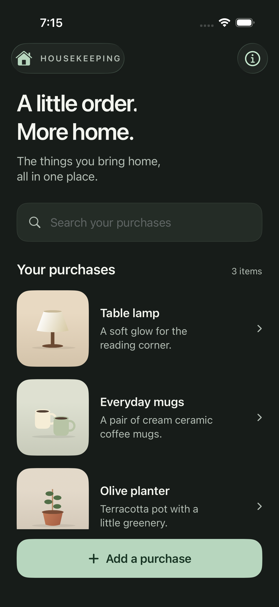
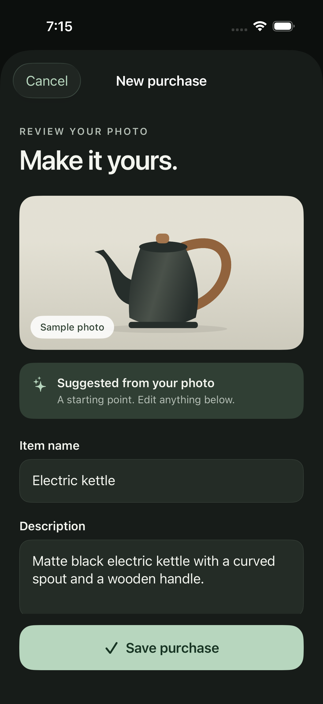

# Simulator design preview

These are screenshots of the runnable SwiftUI demo and synthetic connected fixtures, not production photos or AI results. Product artwork is drawn in SwiftUI. Edits and purchases in demo mode last only for the current app session; the separately configured connected app persists data to Supabase.

## Authentication screens

Captured September 9, 2026 on iPhone 17 Pro / iOS 26.5: [sign in](sign-in-light.png) and [password setup/recovery](password-recovery-light.png). Both were visually inspected and use synthetic offline preview data, the approved ivory/forest styling, and compact primary actions. No real account details appear in these screenshots.

Normal unconfigured launches show setup with **Explore the demo**. Configured launches support sign-in, account states, and persistent shared manual inventory through add/edit/delete and editor recovery. Debug arguments `--preview-auth` and `--preview-recovery` reproduce the authentication screens without networking. `--preview-inventory` exercises the connected screens with explicit offline fixtures.

## Main screens

Task 13 connected captures (September 10, 2026): [inventory](connected-inventory-light.png), [fresh purchase details](connected-detail-light.png), and [largest-text dark inventory](connected-inventory-accessible.png). These were visually inspected on Pro using explicitly labeled offline fixtures, not a live household. The banner occupies layout space instead of covering navigation controls at accessibility sizes. Add/edit/delete and foreground draft recovery are verified by UI journeys; the original demo captures below retain their approved compact actions.

| Inventory | Photo review |
| --- | --- |
|  |  |
|  |  |

Supporting captures: [purchase details](purchase-detail.png), [no search results](no-results.png), [largest accessibility text](inventory-accessible.png), and [accessible photo review](photo-review-accessible.png).

Small-screen captures: [iPhone SE inventory](iphone-se-inventory-accessible.png) and [iPhone SE review](iphone-se-review-accessible.png), both at the largest accessibility text setting. Content scrolls; the bottom action remains reachable.

Updated after design feedback: the four accessibility screenshots now show compact, single-line Add and Save buttons. Only the pinned button labels/icons have capped scaling; surrounding content still uses the largest accessibility text setting. Buttons retain their full-width alignment and minimum 56-point tap height.

## Verification results

September 10 task 13: **80 offline unit tests** and all **15 Pro UI journeys** pass. The two connected write/recovery journeys also pass on SE. The account target is 44 points, and both the connected editor and original demo retain compact, reachable Add/Save actions. See [detailed connected verification](../connected-inventory-development.md).

September 9 authentication update: **11/11 UI tests passed** on iPhone 17 Pro / iOS 26.5 (six authentication and five existing design journeys). The largest-text dark sign-in test verifies a reachable 56–72-point action. The shared scheme also passed 36 offline unit tests; its one opt-in real-server test skips during ordinary runs and passed separately through the guarded local SDK runner. Sign-in/recovery captures were visually inspected. See [authentication verification and remaining device checks](../ios-development.md).

The same update passed **2/2 focused UI tests** on iPhone SE (3rd generation) / iOS 18.3.1: largest-text dark sign-in and inventory/review actions remain compact and reachable.

Task 11's inventory adapter update subsequently passed all **11/11 Pro UI regressions** and 51 offline unit tests. Screens/layouts were unchanged; the adapter has not yet been wired into inventory UI. See [current inventory implementation](../inventory-development.md).

Task 12's draft/state foundation also passes **11/11 Pro UI regressions** and **66 offline unit tests** (two additional device/local-integration checks are skipped). Screens remain unchanged; durable drafts and live inventory state still await screen integration. See [draft/state verification](../draft-state-development.md).

Verified on September 7, 2026 using Xcode 26.6:

- iPhone 17 Pro, iOS 26.5 simulator: **5/5 UI tests passed**. Covers edited sample save and mixed-case multi-field search, detail navigation, blank and overlong-name validation, keeping/discarding edits, no results, dark screenshots, and largest-text action reachability.
- iPhone SE (3rd generation), iOS 18.3.1 simulator: **1/1 additional UI check passed**, verifying Add and Save reachability at the largest accessibility text setting.
- After the button adjustment, the full **5/5** suite passed again. The strengthened accessibility check then passed on **both simulators**, asserting button heights of 56–72 points and confirming that the uncapped screen heading still enlarges. The four refreshed screenshots were visually inspected.
- Swift source formatting lint and Xcode project property-list validation passed. Light/dark screenshots were visually inspected.

This is not a full accessibility audit: VoiceOver, contrast measurements, physical-device camera behavior, and connected-app acceptance tests remain to be done. Runtime screenshots retain simulator status bars and scroll positions without retouching.

Open [the Xcode project](../../ios/HouseKeeping.xcodeproj) to explore the flows. See [the design specification](../design.md) for layout decisions and [the product specification](../spec.md) for the future connected app.
